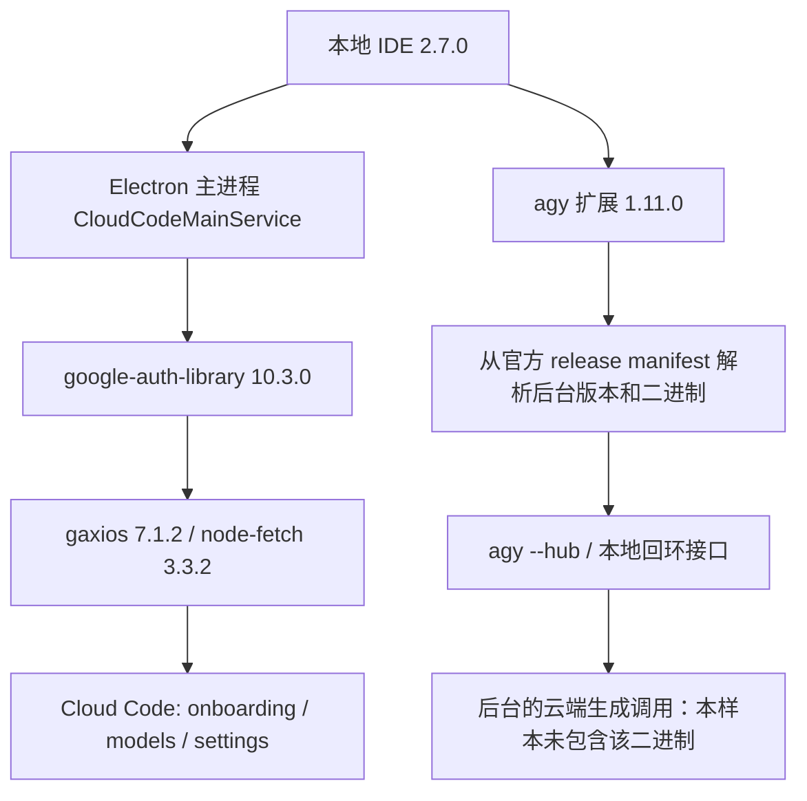

# Antigravity 本地样本：请求指纹静态分析

分析日期：2026-11-16。范围：当前项目中的官方 IDE 安装包及其解出文件。

**结论：已还原本地 IDE 的 Cloud Code 请求构造与依赖库追加头；尚未取得 App 2.32.0 / hub 的完整指纹。两条调用路径必须分别标注。**

## 1. 样本与证据等级

| 项目 | 实际观察 |
| --- | --- |
| 原始文件 | `H:\orca\rea\site\antigravity\installer\Antigravity-IDE-2.7.0-windows-x64.exe` |
| 文件大小 | 199649432 bytes |
| SHA-256 | `307c7a41b050ffe742fd4dd1045050df1464de219271f74b5f6c269e9e00c822` |
| 安装包格式 | Inno Setup 6.4.0，内部签名 `Inno Setup Setup Data (6.4.0.1)` |
| 产品版本 | `product.json.ideVersion = 2.7.0`，`quality = stable` |
| VS Code 基线 | `product.json.version = 1.107.0`，不是 hub 版本 |
| 扩展版本 | `extensions/agy/package.json.version = 1.11.0` |
| 语言服务构建号 | `product.json.languageServerCL = 1018779249` |
| 产品 commit | `71bedb45923debaf49871bdcb7c7d3a47918e247` |
| 产品构建时间 | `2026-11-11T04:46:27.114Z` |
| 打包文件数 | 解包器清单列出 40598 个文件 |
| 后台二进制 | 清单未发现独立 `agy`、`agy.exe`、`hub.exe` 或 `language_server` 文件 |

标记含义：

- **已确认**：文件中的字面量、函数或已解码 protobuf descriptor 能直接支持。
- **静态推导／离线复现**：沿已确认调用链推导，或用原包依赖库和合成输入在本地验证；不是抓包。
- **待确认**：缺少目标后台二进制、运行时参数或真实流量。

`focused-evidence.json` 的 E01–E28 记录文件 SHA-256、从 0 开始的 UTF-8 字节偏移、从 1 开始的行号与原文片段。下文路径均相对解包后的 `resources/app/`。`request-schemas.json` 提供相关 protobuf 字段；`protobuf-descriptors.json` 包含从两个 bundle 解出的 128 个 descriptor。原始安装包未执行、未改写。

## 2. 真实调用链



依据：E03–E10、E15–E25。IDE 主进程确实直接构造部分 `/v1internal:*` 请求；不能因为发现这些请求就认为已经覆盖 hub 的生成链路。

## 3. P0：UA、版本与 changelist

| 字段 | 本样本结果 | 携带位置／来源 | 判定 |
| --- | --- | --- | --- |
| IDE 基础 UA | `antigravity/2.7.0 windows/amd64` | `out/main.js` 的 `userAgent` getter，E03、E04 | 已确认模板；平台值对应本样本 Windows x64 |
| IDE 依赖库处理后的 UA | `antigravity/2.7.0 windows/amd64 google-api-nodejs-client/10.3.0` | 认证库默认 interceptor 追加后缀，E19、E20 | 静态推导并离线复现 |
| 外部版 UA 模板 | `antigravity/{product.ideVersion} {os}/{arch}`，再追加上述库后缀 | `win32 → windows`、`x64 → amd64`、`ia32 → 386` | 已确认 |
| 内部版分支 | 基础 UA 前缀改为 `jetski` | `productService.isGoogleInternal` | 已确认分支，不代表本外部发行版走此分支 |
| `antigravity/hub/X` 的 X | `HUB_VERSION`：待确认 | 所分析 IDE bundle 中未找到该 UA 构造 | 不能用 IDE 2.7.0、扩展 1.11.0 或 CLI 版本替代 |
| changelist | `languageServerCL = "1018779249"` | `product.json`，E02；主进程 About 对话框读取，E28 | 存在已确认 |
| changelist 出站位置 | `CHANGE_LIST_LOCATION`：待确认 | 已定位的 IDE getter、headers、metadata 构造未引用该配置 | 不能据此声称 hub 不发送 changelist |
| version ↔ CL 校准 | 已观察到 IDE 2.7.0 与该 CL 同包存在；没有发现可计算配对的算法 | 产品配置与调用链 | 同包记录，不是 hub 版本配对规则 |

用户提供的目标为 App 2.32.0，本地为 IDE 2.7.0。尚无证据证明二者属于同一产品版本序列，因此不能仅作数字大小比较就标记“过期”。

`#3968`、`#3546` 未提供完整 issue URL，也没有在本次分析中取得 issue 内容。它们与封号、签名错误的因果关系不作为本报告的已确认事实。静态分析没有重现 `TOS_VIOLATION 403`，也不能承诺补齐头会消除该错误。

## 4. P1：HTTP 头

下表适用于已定位的 **IDE 主进程 CloudCodeMainService 路径**。

| HTTP 头 | 值／规则 | 证据与边界 |
| --- | --- | --- |
| `User-Agent` | `antigravity/2.7.0 windows/amd64 google-api-nodejs-client/10.3.0` | E03、E04、E19、E20；离线复现一致 |
| `Authorization` | 通常 `Bearer TOKEN`；库按凭证 `token_type + access_token` 构造 | E10、E21、E22；TOKEN 为脱敏占位 |
| `Content-Type` | `application/json` | E05 显式设置 |
| `X-Goog-Api-Client` | `gl-node/RUNTIME_NODE_VERSION` | E19 读取 `process.version`，不是固定为任意已知 Node 版本 |
| `Accept` | 默认依赖路径为 `*/*` | gaxios 默认 `responseType=unknown`，由 node-fetch 补齐，E24、E25；离线复现一致 |
| `Accept-Encoding` | 默认 `gzip, deflate, br` | node-fetch 在 `compress` 启用且未指定该头时添加，E25；离线复现一致 |
| `Content-Length` | JSON 字符串 UTF-8 字节数 | E24、E25；随 body 改变 |
| `X-Goog-User-Project` | 认证库支持有 quota project 时加入；本请求构造未设置 quota project | E21、E22；不能写成每次必带 |
| `X-Goog-Api-Key` | 库在 `apiKey` 存在时追加；已定位 OAuth2Client 构造未传该配置 | E10、E21；反馈服务中的同名头不属于本云端调用 |
| `X-Client-*`、设备/session 头 | 在本服务的 headers 构造中没有发现 | 仅限已分析分支；hub 仍待确认 |
| `x-cloudaicompanion-trace-id` | 此处是**读取响应头**用于日志 | E05、E06；不能列作客户端发送的必需头 |
| `Host`、`Connection`、代理追加头 | `TRANSPORT_HEADERS`：待确认 | 可能由 Node、agent 或代理生成，离线适配器未记录实际传输 |

认证库的 `X-Goog-Api-Client` 格式恰好也是 `gl-node/...`。因此用户所述“只有这个 X-Goog 头，头太干净”本身不是异常证据；还需要相同产品、版本和 action 的实际请求对照。

### 头序

`node-fetch/src/headers.js` 会将名字转小写，并在 `keys()` 中排序；转换给 Node 请求层的头对象可离线观察到按名称排序的顺序，见 E26。但最终 wire 头序、Node 自动补头、代理变化以及 TLS/HTTP 协商没有抓取。不能从 JS 对象书写顺序推断最终头序，也没有证据证明此服务以头序作为风控判断。

### 离线验证

执行 `node site/antigravity/analysis/verify-offline-headers.mjs`，使用安装包里的认证与 HTTP 依赖，并拦截 fetch adapter，不发网络请求。输入中使用合成 `TOKEN`、`PROJECT`。

实际输出保存在 `offline-header-verification.json`：

```text
User-Agent: antigravity/2.7.0 windows/amd64 google-api-nodejs-client/10.3.0
X-Goog-Api-Client: gl-node/22.19.0
Authorization: Bearer TOKEN
Accept: */*
Accept-Encoding: gzip, deflate, br
Content-Type: application/json
Content-Length: 123
exitStatus: 0
```

这里的 `22.19.0` 是**分析机 Node**，不是官方 Electron 的运行时版本。包内 `engines.node=22.20.0` 与开发依赖 `electron=39.2.3` 仅是构建配置，不能用来冒充抓包中的运行时头。

## 5. P1：请求体

### 5.1 关键序列化层：实际数据采用 snake_case

E05 的发送代码为：

```javascript
data: kEn(nZn(requestSchema, requestMessage))
```

`nZn` 先按 protobuf JSON 规则转换，`kEn` 再递归把大写字母变成下划线加小写字母。因而内部 JS 的 `ideType`、`ideVersion` 在这里分别成为发送数据中的 `ide_type`、`ide_version`。这适用于所定位的 IDE 服务，不应直接外推至 hub。

### 5.2 ClientMetadata 完整 schema

来源：`onboarding.proto` 的 `ClientMetadata`，从内嵌 descriptor 解码，见 `request-schemas.json`。该消息没有 `changelist`、`installation_id`、`clientMetadata`、`inVersion` 或 `systemInstruction` 字段。

| protobuf 编号 | 内部 JS／ProtoJSON 名 | 本服务发送数据名 | 本服务构造值 |
| --- | --- | --- | --- |
| 1 | `ideType` | `ide_type` | 外部版 `ANTIGRAVITY`（枚举值 9）；内部版 `JETSKI`（10） |
| 2 | `ideVersion` | `ide_version` | `"2.7.0"` |
| 3 | `pluginVersion` | `plugin_version` | 本 getter 未设置，隐式默认值不主动输出 |
| 4 | `platform` | `platform` | schema 包含 `WINDOWS_AMD64=5`，本 getter 未设置 |
| 5 | `updateChannel` | `update_channel` | 本 getter 未设置 |
| 6 | `duetProject` | `duet_project` | 本 getter 未设置 |
| 7 | `pluginType` | `plugin_type` | 本 getter 未设置 |
| 8 | `ideName` | `ide_name` | 外部版 `"antigravity"`；内部版 `"jetski"` |

“schema 支持”与“请求构造实际设置”应分开记录，不能把全部 schema 字段补进发送模板当作真实客户端值。

### 5.3 action 对应数据

| action | 代码中实际设置的字段 | 尚需运行时补足 |
| --- | --- | --- |
| `loadCodeAssist` | `metadata`、`cloudaicompanionProject`；后者来自显式参数或统一状态中的 GCP 项目 | 项目可能为 undefined；该可选字段实际是否出现取决于状态 |
| `onboardUser` | `tierId`、`cloudaicompanionProject`、`metadata` | `TIER_ID`、`PROJECT` |
| `fetchAvailableModels` | `project` | `_cloudAiCompanionProject` 的真实值；空隐式默认值可被省略 |
| `generateContent`／`streamGenerateContent` | 未在所定位 IDE CloudCode 服务中发现直接发送实现 | 需后台二进制或其真实流量 |

`FetchAvailableModelsRequest` schema 还包含 `request_id`、`entitlement`、`location`，但当前调用点只设置 `project`，并没有 metadata 块。

以下是从源码重建、填入合成项目值后的 `loadCodeAssist` 数据示例；不是实抓账户请求：

```json
{
  "cloudaicompanion_project": "PROJECT",
  "metadata": {
    "ide_type": "ANTIGRAVITY",
    "ide_version": "2.7.0",
    "ide_name": "antigravity"
  }
}
```

生成请求的 `systemInstruction`、身份前导文本以及安装标识：`SYSTEM_INSTRUCTION`、`INSTALLATION_ID`，均待后台样本确认。

## 6. P2：OAuth

| 项目 | 静态结果 | 证据 |
| --- | --- | --- |
| 常规模式 client_id | `1071006060591-tmhssin2h21lcre235vtolojh4g403ep.apps.googleusercontent.com` | E27 |
| GCP ToS 模式 client_id | `884354919052-36trc1jjb3tguiac32ov6cod268c5blh.apps.googleusercontent.com` | E10–E12、E27 |
| 两套配置选择 | 按 `isGcpTos` 布尔分支选择对应配置 | E10–E12；是产品模式分支，未发现凭证轮换实现 |
| 内嵌 client_secret | 两组均存在；报告用 SHA-256 标识，见下表 | E27；不说明其仍获服务端认可 |
| redirect_uri | `http://localhost:PORT/oauth-callback` | E11 |
| 授权 URL 参数 | `access_type=offline`、五项 scope、随机 `state`、`prompt=consent` | E11 |
| PKCE | 此授权 URL 构造未传 `code_challenge`；换码调用为 `getToken(code)`，未传 verifier | E11、E12；库具备 PKCE 能力不等于客户端此分支使用 |
| 吊销／有效性 | `OAUTH_CREDENTIAL_VALIDITY`：待确认 | 静态文件不能验证服务端当前状态 |

client_secret 对照指纹（按对应模式）：

| 模式 | 内嵌常量 SHA-256 |
| --- | --- |
| 常规 | `1d2f041093fd95aa8995a038c711d50a7960da09a505381c09a745d6ad0ecc60` |
| GCP ToS | `a2ddedc84850a9c48b7e01d61700848083bf0e10fb8d6c99c496803e8b48ced0` |

五项 scope 原文：

```text
https://www.googleapis.com/auth/cloud-platform
https://www.googleapis.com/auth/userinfo.email
https://www.googleapis.com/auth/userinfo.profile
https://www.googleapis.com/auth/cclog
https://www.googleapis.com/auth/experimentsandconfigs
```

## 7. P2：端点、流式与签名

E09 中的 base URL 选择顺序为：

1. 显式 `jetski.cloudCodeUrl` 配置覆盖。
2. 内部版且开发模式：`https://autopush-cloudcode-pa.sandbox.googleapis.com`。
3. 其余内部版：`https://preprod-daily-cloudcode-pa.sandbox.googleapis.com`。
4. 外部版且 OAuth 为 GCP ToS、tier 为 GCP ToS，或 tier 状态尚未知：`https://cloudcode-pa.googleapis.com`。
5. 其余外部版：`https://daily-cloudcode-pa.googleapis.com`。

此逻辑说明主域与 daily 域并非只按“稳定／测试”切换，也受账户／tier 状态影响。

已定位服务中的 action 集合：

```text
POST /v1internal:loadCodeAssist
POST /v1internal:onboardUser
POST /v1internal:fetchUserInfo
POST /v1internal:fetchAvailableModels
POST /v1internal:fetchAdminControls
POST /v1internal:setUserSettings
POST /v1internal:recordCodeAssistMetrics
GET  /v1internal/cascadeNuxes
GET  /v1internal/OPERATION_NAME    # onboardUser 未完成时轮询
```

这是**该服务的已观察集合**，不是整个 Antigravity 产品的 action 全集。

| 项目 | 结果 |
| --- | --- |
| `?alt=sse` | `STREAM_QUERY`：此 IDE 服务没有定位到生成流式请求实现 |
| HMAC／请求签名 | 当前直接请求构造未发现签名头；后台链路未知 |
| thought signature schema | `exa.codeium_common_pb.ChatToolCall` 含 `thought_signature`（字段 6，string）、`thinking_signature`（7，string），以及 `function_call_parts`（10） |
| thought signature 实际处理 | `THOUGHT_SIGNATURE_FLOW`：descriptor 存在不证明生成／验证／回传规则；后台实现未取得 |
| 安装／设备 ID | 不能把其他遥测代码里的 `machineId` 当成该云端请求的必需头 |

## 8. 版本权威来源的已观察结果

本样本内找到两套不同产品的官方更新机制，详见 `version-sources.md`：

- IDE：`Zqe` 构造 Google Cloud Run 上的 `/api/update/{platform}/{quality}/{commit}/{host_hash}`。`product.json.updateUrl` 字面值虽是 `https://example.com`，实际 feed 构造另有硬编码，不应直接解析该字段作为真实下载源。
- CLI：扩展读取平台 manifest；本次从源码默认地址只读取回 `version=1.5.9`、二进制 URL、SHA-512，原始响应保存为 `cli-manifest-windows-amd64.json`。该响应是分析当天取得的 CLI 快照，不是 App 2.32.0 或 hub 版本的证明。

## 9. 验收与仍缺证据

本次完成：原包哈希复核、静态解包、IDE UA 与依赖库头追踪、请求体与 schema 解码、OAuth 模式与 scope、直接服务 action 和 base URL 分支、官方更新机制定位、离线依赖复现、Subway 对照清单。

尚未满足用户原始“完整 hub 指纹”的验收项：

| 缺项 | 需要的最小证据 |
| --- | --- |
| App 2.32.0 的 hub UA 与版本 | 该发行版对应的后台二进制、版本 sidecar 或真实请求 |
| hub version ↔ changelist 配对和出站位置 | 同一个后台构建的版本元数据与实际请求构造／流量 |
| 生成请求体、systemInstruction、流式参数 | 后台二进制或生成调用的脱敏抓包 |
| 最终全部头、线序与 TLS/HTTP | 对应版本、平台、action 的运行时请求 |
| Subway 当前实现差异 | Subway 代码／配置或请求样本；当前工作区未定位到该实现 |
| 线上账户、proxy、Gemini CLI 用量 | 线上查询结果；本次静态任务未连接 SSH 或生产数据库 |

静态未检出项均限制在本报告记录的文件范围，不能当作整个产品“不存在该机制”的结论。
