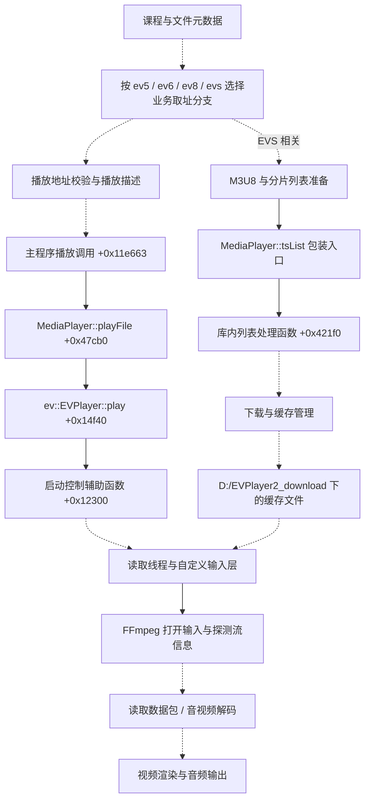

# EVPlayer2 视频获取与解析流程

分析日期：2026-11-10。沿用项目 `H:/orca/rea/site/evplayer2` 和原会话 PID 56664，目标仍为 `F:/EVPlayer2/EVPlayer2.exe`。本次新增静态 PE/字符串交叉引用、运行时代码反汇编、打开文件句柄、缓存格式元数据及媒体/网络入口观测。

目前可以把流程分成两条相连但尚未完整动态贯通的链：**业务层拿播放描述和分片列表**，以及 **播放库通过输入处理层喂给 FFmpeg**。获取视频、解析 M3U8、读取缓存和容器解复用是不同环节。

## 流程图

实线表示本次确认的代码调用或直接观测；虚线表示由静态字段和日志关联出的流程关系，尚未捕获同一播放操作中的完整时序。



图中的缓存管理、输入处理和解码层有对应代码及字符串证据；虚线不代表本轮已经逐段捕获运行时参数。

## 1. 业务层先获取播放描述

主程序静态字段包含 `file_items`、`file_id`、`path`、`etype`、`course_id`。它们支持“课程/文件元数据参与播放描述生成”的判断，尚不能当成已捕获的请求 JSON schema。

不同取址分支分别落在以下 PE 异常表函数范围中。名称是依据函数内的日志标记附加的分析标签，不是恢复出的原始 C++ 符号。

| 分支/阶段 | EVPlayer2.exe 函数起始 RVA | 证据 |
|---|---|---|
| ev5 取址分支 | `0x4de40` | `get file play url failed! ev5` |
| ev6 取址分支 | `0x4abc0` | `get file play url failed! ev6` |
| ev8 取址分支 | `0x538a0` | `get file play url failed! ev8` |
| evs 取址分支 | `0x4fa10` | `get file play url failed! evs` |
| 视频 URL 校验相关 | `0x54dc0` | `check video url sign failed` |
| signUrl 结果处理相关 | `0x4bcf0` | `ev2_signUrl` 和解析失败日志 |
| EVS 下载信息处理相关 | `0x52cb0` | `ev2_evsDown`、M3U8/tsList 日志 |

这些是代码中的分支标记。尚未把 ev5/ev6/ev8/evs 与当前视频的具体类型字段值或本地文件扩展名逐项对应。

静态发现 `/student/getDownEVSKey` 和 `/student/getEvsSignUrlByKey?key=` 等业务路径。这里仅确认路径及调用附近的日志，未发起这些请求，也未记录其认证参数或响应内容。业务 HOST、完整播放 URL、响应字段和值仍未确认。

已有 `version.ieway.cn` 更新端点不能据此解释为视频源；历史出现过的远端 IP 也没有在本轮与具体播放 URL 建立一一对应。

## 2. EVS 相关流程还会处理 M3U8 / TS 列表

业务日志包含：`begin get tsList from Mediaplayer: m3u8:...`，以及 `get MediaPlayer tsList Failed! tsList is Empty`、`parse test MediaPlayer tsList Failed`。

主程序中两处实际 call 指令，经同一导入跳板进入 `MediaPlayer::tsList`：

- `EVPlayer2.exe+0x4c8a9`，所在函数 `+0x4c860`。
- `EVPlayer2.exe+0x4dbcc`，所在函数 `+0x4db90`。
- 导入跳板：`EVPlayer2.exe+0x190e9c`。
- 库导出入口：`PlayerLibRender56_vs.dll+0x48590`。
- 包装入口 `+0x48599` 进一步 call 库内 `+0x421f0`。

导出签名表明 `tsList` 接受两个 `const std::string&` 参数并返回 `std::string`。主程序还会解析返回字符串，不能将这个函数简单理解成“打开容器并解码视频”。静态字段和日志中可见 `tsDownloadUrl`、`tsUrl`、`cache_key`、`ts_liststr`；完整列表格式及第二参数的具体语义未在本轮动态确认。观测器只记录第一输入的长度，不读取第二输入。

## 3. 视频数据存在本地分片缓存环节

通过当前进程的句柄快照，确认 PID 56664 持有 `D:/EVPlayer2_download` 下两个 `.ts` 文件。第一次目录采样为 1367 个 `.ts`，后一次为 1431 个 `.ts`，另有 6 个 `.tmp` 和 1 个 `.evtemp`。数量属于各次采样状态，不是固定总数；目录增长本身不能单独证明具体写入进程。

后一次进程句柄对应的样本：

| 文件名 | 文件长度 | 前 64 KiB 的 TS 同步检测 |
|---|---:|---|
| `143710-acea0910-8006-480d-92a0-0dbb7d20a8ed.ts` | 836800 | 未找到稳定的 188/192/204 字节包排列 |
| `143710-1f0c9000-208a-460b-b230-d3938bcfe80a.ts` | 494064 | 未找到稳定的 188/192/204 字节包排列 |

两个文件的长度都是 16 的倍数。这只是格式线索，不能据此判定具体算法，也不能只根据 `.ts` 后缀把它们解释成可直接解析的普通 MPEG-TS。没有识别到 TS 同步结构，因此没有从这些样本得到 PAT/PMT、视频编码或音轨参数。检测只读取各样本前 64 KiB，没有导出媒体内容。

库内存在 `open_hls_cache_file`、`getRemoteFileSize`、`restclient_download`、文件大小校验、临时文件处理和 `ev_rename` 等日志，对应缓存打开、下载校验和落盘管理。已定位的两个入口包括：

- `PlayerLibRender56_vs.dll+0x38e70`：HLS 缓存打开相关函数，引用 `open_hls_cache_file`。
- `PlayerLibRender56_vs.dll+0x43f50`：TS 上下文查找相关函数，引用 `open_ts_ctx ... not found`。

这些日志支持存在缓存管理子系统；本轮 12 秒目录监听未捕获新文件事件，不能把临时文件到最终文件的改名时序写成已观察事实。

## 4. 播放入口与输入层

主程序 `+0x11e663` 经 `+0x190ed8` 导入跳板调用 `MediaPlayer::playFile(QString const&)`。该参数应暂称“播放描述”；没有新调用参数，尚不能断定它总是普通文件路径或直接 HTTP URL。

已由运行时代码反汇编确认：

| 调用关系 | call 指令 RVA | 目标 RVA |
|---|---|---|
| 主程序 → `MediaPlayer::playFile` | EXE `0x11e663` | DLL `0x47cb0`，经导入跳板 |
| `MediaPlayer::playFile` → `ev::EVPlayer::play` | DLL `0x47ef5` | DLL `0x14f40` |
| `ev::EVPlayer::play` → 启动控制辅助函数 | DLL `0x151f8` | DLL `0x12300` |

`ev::EVPlayer::play` 的导出签名除源字符串外，还带 `CtrlFunc`、布尔值和整数参数，表明业务描述之外还存在控制参数。

库内的 `DecryptFilterMgr`、`createFilter`、`ioRead`、`Decryptor_EVS`、`M3u8Ctx`、HLS 缓存标记，说明 FFmpeg 前存在自定义输入处理体系。读取线程代码也包含进入输入处理辅助函数后再打开 FFmpeg 输入的路径。这里只定位层次和连接点，尚未确认当前样本选用了其中哪个处理器。

## 5. FFmpeg 接收输入，再做容器探测与解码

库中保留了 `ev_reader.cpp`、`ev_decoder.cpp`、`ev_play.cpp` 源路径，以及 FFmpeg 4.2.9 的构建路径。FFmpeg 相关函数并不作为同名 DLL 导出出现，以下名字依据调用形态、相邻日志及代码关系识别，不等同于加载了原始调试符号。

- 读取线程相关函数：`PlayerLibRender56_vs.dll+0xee40`，包含 `av_read_frame` 错误日志及读取退出处理。
- `+0xf5e8` 调用 `+0x4b13c4`；参数形态及后续调用支持将后者识别为 `avformat_open_input`。
- `+0x4b13c4` 内的 `+0x4b1501` 调用 `+0x4b696c`，后者包含 `Custom AVIOContext ... AVFMT_NOFILE` 的输入初始化日志。这与自定义 I/O 的存在相容，但不能单凭 FFmpeg 通用日志证明当前选用了 custom AVIO。
- 读取线程 `+0xfa3f` 调用 `+0x4af520`。后者含 `Before/After avformat_find_stream_info` 日志，可高可信识别为流信息探测函数。
- `+0x596c0` 含 `No codec provided to avcodec_open2()` 日志；流信息探测函数也有对它的调用，支持编解码器初始化链的识别。

因此可将后半段概括为：**输入层供给数据 → 打开媒体输入 → 探测音视频流 → 读取数据包 → 解码与输出**。本轮恢复的是实现路径和调用连接，没有捕获当前视频的完整时序、具体 demuxer、codec 或像素格式。

输出组件方面，导出/源码字符串中存在 `Surface`、`RenderImpl`、YUV OpenGL、Qt/QML 和 RtAudio。它们证明库包含相应输出能力，尚未确认当前视频具体选择的渲染后端。

## 6. 本轮动态验证与限制

执行了 6 组检查，退出状态均为 0：PE 清单、媒体 probe、缓存元数据、线程栈、调用图和传输观测。

- 媒体 probe：安装 `playFile`、`EVPlayer::play`、`tsList`、`setVideoOut` 共 4 个 hook，观测 12 秒，没有新入口调用；卸载后 4/4 个入口的 16 字节恢复。
- 传输观测：安装 `send`、`WSASend`、`recv` 共 3 个 hook，只准备记录 HTTP 方法、Host、状态等元数据；12 秒内未命中目标模块调用，未捕获实际视频请求。卸载后 3/3 个入口恢复。
- 线程快照包含媒体库工作线程，但未捕获贯穿取址、缓存和解复用的同一条调用栈。
- 原 EXE 与渲染 DLL 的 SHA-256 与本轮静态清单一致，原 PID 56664 保留。

不能把“hook 安装成功”解释成“已经捕获真实播放 URL”，也不能把未命中解释成程序没有网络或播放行为。

## 7. 文件与后续复用

- `media/inventory.mjs`：PE 导入、导出、异常表函数范围和字符串交叉引用。
- `media/probe_media.mjs`：媒体入口、进程文件句柄和指定函数反汇编。
- `media/inspect_cache.mjs`：当前持有缓存样本的 TS 元数据检测。
- `media/build_callgraph.mjs`：依据已解码指令生成调用图与引用关系。
- `media/observe_transfer.mjs`：限定目标模块的 HTTP 元数据与缓存目录观测。
- `media/execution_records.json`：实际命令、literal stdout/stderr 与 exit status。
- `media/media_callgraph.json`、`media/input_layer_xrefs.json`：机器可读调用证据。

在发生新的播放操作前启动媒体观测器：

```powershell
Set-Location H:/orca/rea/site/evplayer2/media
node ./probe_media.mjs --pid 56664 --seconds 60
```

它记录源描述的类型/长度；普通 URL 不记录 query 值，`tsList` 不读取第二输入。运行结束会检查入口恢复状态。

沿用原四个固定角色：

1. `H:/orca/rea/site/evplayer2/hooks/hook_checks.js`
2. `H:/orca/rea/site/evplayer2/hooks/hook_checks.patch`
3. `H:/orca/rea/site/evplayer2/hooks/VERIFICATION.txt`
4. `H:/orca/rea/site/evplayer2/hooks/ROLLBACK.sh`

本轮没有改动该检测脚本及其补丁或回滚实现，只将新检查的执行记录追加到验证文件。此前对照仍为：BASELINE 关闭 hook、MODIFIED 安装 15 个 hook、ROLLBACK 恢复基线；三组退出 0，调试器自检输出为 0、主窗口 affinity 为 1，MODIFIED 卸载后 15/15 个入口恢复。上述为此前已观测结果，不是本轮重新执行的对照。

下一步最有价值的验证是在同一新播放操作中关联“业务取址完成 → tsList / playFile 入参类型 → 缓存打开”的时序，确定当前视频实际走哪个分支。